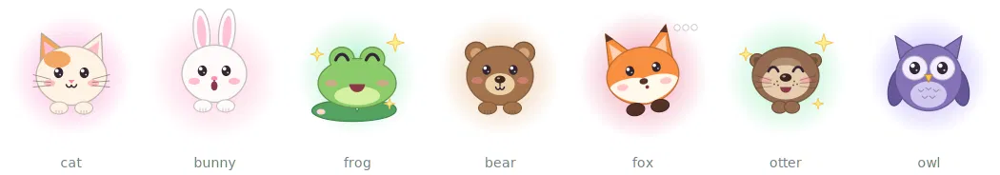
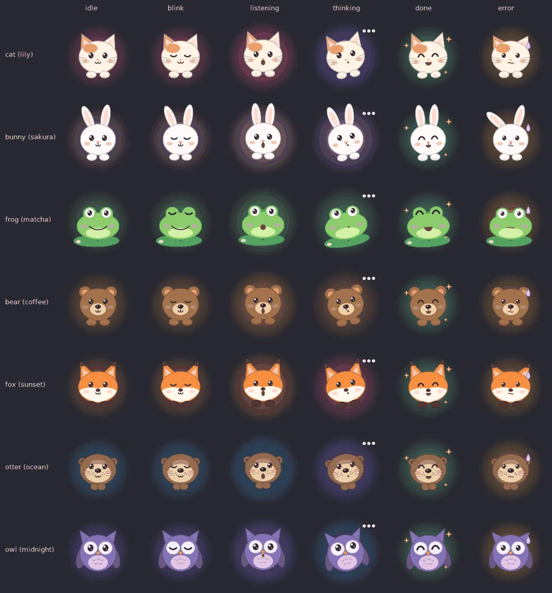

# hey-mac

[](https://github.com/tinexu/hey-mac/actions/workflows/tests.yml)
[](LICENSE)


A voice assistant for your Mac, a bit like Siri, ChatGPT and Claude combined. Say **"hey jarvis"** (or press
**⌥ Space**, or just type) and a little animal pops up in the corner of your screen to help.

<p align="center"></p>

- **Hears you correctly.** Speech recognition runs on your Mac with Whisper large-v3-turbo, which is much more
  accurate than Siri. Add words it should expect (app names, project names) to a vocabulary list.
- **Finds files, even when you forget the name.** "find the instructions for my hw2" searches by what the file
  is about. Then say "open the second one" or click a result.
- **Controls your Mac.** "open messages", "quit chrome", "lock the computer" and "volume 30" run instantly,
  without the AI.
- **Talks to the other AIs for you.** "ask ChatGPT to review my resume" opens ChatGPT in Chrome, attaches the
  real file, types the prompt and sends it. Works with Claude, Gemini and Perplexity too.
- **Notes and messages.** "add eggs to my grocery list" writes to Apple Notes; "text me this page" sends it to
  your phone.
- **Aesthetics.** "coffee mode" switches your wallpaper, dark mode, Spotify playlist, editor theme and Dock in
  one go, and "back to normal" undoes it.
- **Handles harder requests with the AI you choose.** "open a new Cursor window with my portfolio folder" goes to
  Claude by default, or OpenAI, Gemini, or a free local model through Ollama. It picks from a fixed set of safe
  actions.

## How it works

```
 mic ─► wake word (openWakeWord, local) ─┐
 ⌥Space hotkey / typing ─────────────────┴─► record until you stop talking
                                             │
                                  Whisper (local, mlx) → text
                                             │
                 ┌───────────────────────────┴───────────────────────┐
     simple command? (open/quit/lock/volume/notes/…)             anything else
          │  instant, free                                           │
          ▼                                     your AI + tools (Claude, OpenAI,
     Mac actions  ◄──────────────────────────── Gemini or Ollama on your Mac)
          │
   the mascot in the corner shows the result
```

The AI can only use a fixed list of actions (open or quit apps, find and open files, open projects in an editor,
notes, messages to yourself, presets, volume, media, web search…). It **can't** run arbitrary shell commands.

## Privacy

- Your **voice never leaves your Mac**. The wake word and speech recognition both run locally.
- **Simple commands stay local** too. Nothing is sent anywhere for "open messages" or "volume 30".
- For **AI commands**, the text of what you said, plus the results of the actions it takes (for example file names
  from a search, a peek at a file's text, or a note's text if you ask what's on a list), is sent to the AI
  provider you picked (Anthropic by default), using your own key.
- **With Ollama, nothing leaves your Mac at all.** The AI runs locally too.
- When you ask **ChatGPT, Gemini, Claude or Perplexity** something, that prompt and any file you attach go to
  that service in Chrome, exactly as if you'd typed it yourself.
- There's no analytics, telemetry or account. Your settings live in `~/.config/heymac/`.

## Setup (about 5 minutes)

You need an **Apple Silicon Mac** (macOS 13.5 or newer), **[Homebrew](https://brew.sh)** and either an API key
(**[Anthropic](https://console.anthropic.com/)** by default, or OpenAI or Gemini) or **[Ollama](https://ollama.com)**
for a free, fully local AI. See [Choosing your AI](#choosing-your-ai).

```bash
git clone https://github.com/tinexu/hey-mac.git && cd hey-mac
./scripts/setup.sh              # creates .venv, installs everything, downloads the wake word models
open -e .env                    # paste your API key (skip for Ollama)
./scripts/make_app.sh           # builds "Hey Mac.app" in ~/Applications and starts it
```

The first start downloads the Whisper model (~1.5 GB). The menu bar icon (〰) shows **Ready** when it's done.
Logs go to `~/Library/Logs/heymac.log`. To start it at login, add **Hey Mac** in System Settings → General →
Login Items.

Prefer Terminal? `source .venv/bin/activate && heymac` runs the same thing in the foreground.

### macOS permissions

Give these to **Hey Mac** (or to your terminal app, if you run `heymac` from Terminal):

| Permission | Why | Where |
|---|---|---|
| Microphone | hearing you | macOS asks automatically |
| Accessibility | ⌥Space hotkey, lock screen, typing into chatbots | System Settings → Privacy & Security → Accessibility |
| Automation | quitting apps, Notes, Messages, Spotify, Chrome | macOS asks the first time each is used |

Restart the app after you grant Accessibility.

### Updating and restarting

Changes to `~/.config/heymac/config.toml` apply on their own within a couple of seconds (except the hotkey, wake
word, microphone and UI style). After changing the code, restart:

```bash
pkill -f heymac; sleep 2; open ~/Applications/"Hey Mac.app"
```

### Test without the mic

```bash
heymac --text "quit chrome"
heymac --text "find my resume"
heymac --list-mics
python -m pytest                # unit tests, no Mac needed
```

## Things to say

| You say | What happens | AI used? |
|---|---|---|
| open messages / launch spotify | opens the app (fuzzy, "spotfy" works) | no |
| quit chrome / close slack | quits it | no |
| lock the computer / go to sleep | locks / sleeps | no |
| volume 30 / mute / louder | sound | no |
| pause / next song | Spotify or Music | no |
| what time is it | time + battery | no |
| find my resume | ranked file list | yes |
| open the second one / show 2 in finder | opens from the list | no |
| open cursor with my portfolio project | new Cursor window on that folder | yes |
| where's that pdf about taxes from last year | Spotlight + content search | yes |
| search the web for best ramen near me | Google in the browser | yes |
| ask Claude how to reverse a linked list | opens Claude in Chrome and sends it | no |
| open Gemini and ask it … / search … on Perplexity | same for Gemini, ChatGPT, Perplexity | no |
| ask ChatGPT to summarize my cs101 hw2 instructions | finds the file, sends its text along | yes |
| text me a note: buy milk / send me this page / send me what I copied | iMessage to yourself | no |
| send my cs101 hw2 instructions to my phone | finds the file, texts it to you | yes |
| airdrop this page to my phone | opens the AirDrop picker | no |
| take a note: call the dentist tomorrow | new note in Apple Notes | no |
| add eggs to my grocery list | adds a line to that note (makes it if needed) | no |
| what's on my grocery list? | reads the note and answers | yes |
| send my resume to ChatGPT and ask for feedback | attaches the real file, types the prompt, sends | yes |
| ask Gemini what's in my latest screenshot | finds your newest screenshot and attaches it | yes |

## Aesthetics (presets)

Say **"coffee mode"**, **"change my aesthetic to matcha"** or pick one from the menu bar, and one preset switches
your wallpaper, light/dark mode, Spotify playlist, the lily's colors, your Cursor/VS Code theme, the Dock,
accent color, a Focus (via an Apple Shortcut) and which apps are open, all at once. **"Undo my aesthetic"** puts
everything back; **"save my setup as a preset called rainy day"** captures what you have now.

Presets live in `~/.config/heymac/config.toml` under `[presets.<name>]`; see `config.example.toml` for every option.
Lily palettes: `lily`, `coffee`, `matcha`, `ocean`, `sakura`, `midnight`, `sunset`, or your own three hex colors.

### Mascots



Instead of the lily, a little animal drawn in code sits in the corner: **cat, bunny, frog, bear, fox, otter or owl**.
It blinks and breathes while idle, perks its ears and moves its mouth with your voice, tilts its head while
thinking, does happy ^^ eyes with sparkles when it's done, and gets a sweat drop when something fails. Each
aesthetic brings its own animal (coffee → bear, matcha → frog, ocean → otter, sakura → bunny, midnight → owl,
sunset → fox), or set `mascot = "fox"` in a preset. Say **"be a fox"**, **"change your mascot to an owl"** or
**"go back to the lily"** any time; `[ui] mascot` sets the default (`auto`, `lily`, or one animal).

Limits: wallpaper changes the current desktop Space on each display; accent color reaches some apps only after
they're reopened; Spotify needs the desktop app; app icons, the menu bar and Chrome's theme can't be changed.

## Customising

Edit `~/.config/heymac/config.toml` (menu bar → *Open config file*):

- **`[files] project_roots`**: where your code lives, e.g. `~/code`. This is how "open *X* in Cursor" finds projects.
- **`[aliases]`**: nicknames, e.g. `"ide" = "Cursor"`.
- **`[speech] vocabulary`**: words Whisper keeps mishearing, e.g. your project names.
- **`[activation] hotkey`**: e.g. `"cmd+shift+j"`.
- **`[assistant] speak_replies = true`**: have it talk back.
- **On an 8 GB Mac**: set `[speech] model = "mlx-community/whisper-small.en-mlx"`.

### Using your own wake word ("hey <computer name>")

The built-in wake words are `hey_jarvis`, `alexa` and `hey_mycroft`. For a custom one:

1. Open the [openWakeWord training notebook](https://github.com/dscripka/openWakeWord#training-new-models) in Google Colab. It generates synthetic voices, so you don't need to record anything, and takes about an hour.
2. Download the `.onnx` file and set `wake_word = "/path/to/hey_mymac.onnx"`.

## Choosing your AI

Simple commands ("open spotify", "volume 30", "take a note…") never use an AI. For everything else, pick a
provider in `~/.config/heymac/config.toml`:

```toml
[ai]
provider = "ollama"        # anthropic (default) | openai | gemini | ollama | openai_compatible
model = ""                 # empty = the default below
```

| Provider | Default model | Key in `.env` | Notes |
|---|---|---|---|
| `anthropic` | `claude-haiku-4-5` | `ANTHROPIC_API_KEY` | Default, most tested |
| `openai` | `gpt-6-luna` | `OPENAI_API_KEY` | Uses the Responses API, nothing stored by OpenAI |
| `gemini` | `gemini-3.8-flash` | `GEMINI_API_KEY` | Google has a free tier ([get a key](https://aistudio.google.com/apikey)) |
| `ollama` | `qwen3:8b` | none | Free and private; runs on your Mac |
| `openai_compatible` | you choose | `api_key_env` | LM Studio, OpenRouter, Groq… set `base_url` too |

**Ollama:** install it from [ollama.com](https://ollama.com), run `ollama pull qwen3:8b`, set
`provider = "ollama"`, and keep the Ollama app running. Small local models are slower and make more mistakes
with multi-step requests (like finding a file by description) than the cloud models; a 16 GB Mac is comfortable
with an 8B model. Any Ollama model with tool support works; pick one tagged "tools" on ollama.com.

The config reloads when you save it, so you can switch providers without restarting. If something's wrong (no key,
Ollama not running, a model that doesn't exist), the mascot tells you what to fix.

## Cost

Simple commands never call the AI. An AI command uses about 2–4k tokens. With Claude Haiku 4.5 ($1/M input,
$5/M output) that's roughly **$0.003–0.01 each**, so 20 a day comes to about $2–5 a month. Smaller models like
`gpt-6-luna` or Gemini Flash cost less, and Ollama is free.

## Third-party models and licenses

hey-mac's own code is MIT-licensed. It downloads these when you set it up:

- **Whisper large-v3-turbo** (OpenAI, MIT), via [mlx-whisper](https://github.com/ml-explore/mlx-examples).
- **[openWakeWord](https://github.com/dscripka/openWakeWord)** (code Apache 2.0). Its pre-trained wake word models,
  including "hey jarvis", are licensed **[CC BY-NC-SA 4.0](https://creativecommons.org/licenses/by-nc-sa/4.0/)**,
  which means non-commercial use only. They aren't included in this repo. If you build something commercial on
  hey-mac, train your own wake word (see above) or turn the wake word off and use the hotkey.

hey-mac isn't affiliated with Apple, Anthropic, OpenAI, Google, Ollama, Perplexity or Spotify.

## Uninstall

```bash
pkill -f heymac
rm -rf ~/Applications/"Hey Mac.app" ~/.config/heymac ~/Library/Logs/heymac.log
rm -rf /path/to/hey-mac          # the cloned folder
```

The Whisper model is cached in `~/.cache/huggingface`; delete it there if you want the space back.

## Ideas for later

- Calendar and Reminders
- Window tiling ("put Cursor on the left and Chrome on the right")
- Streaming transcription so text appears while you talk
- A signed, notarized download so you don't need Python

## Contributing

Issues and pull requests are welcome. See [CONTRIBUTING.md](CONTRIBUTING.md) for setup and how to add a voice
command or a new mascot. Please report security problems privately ([SECURITY.md](SECURITY.md)).

## License

[MIT](LICENSE) © 2026 Christine Xu